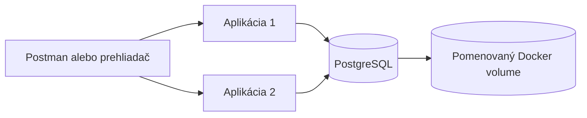

# Docker zadanie – knižničný systém

Príkazy sú pre PowerShell, spúšťaj ich v koreňovom priečinku projektu.
Potrebuješ spustený Docker Desktop v režime **Linux containers**.
Na vytvorenie image nepotrebuješ lokálne inštalovať Maven ani Javu: zostavenie prebieha v Dockeri.



| Bod zadania | Riešenie | Čo ukázať pri odovzdaní |
| --- | --- | --- |
| Vytvorenie kontajnera (1 b.) | `Dockerfile` | Zostavenie image a bežiaci kontajner |
| Interakcia s aplikáciou (2 b.) | REST API na porte 8081 v kontajneri | Login, pridanie knihy a zoznam kníh v Postmane |
| Perzistencia vo volume (2 b.) | PostgreSQL a pomenovaný volume | Kniha zostane aj po `docker compose down` a novom `up` |
| Vzdialený repozitár (1 b.) | `viktorbarczi/pims_zadanie:1.0` | Úspešný push, tag v Docker Hube a pull |
| Viac inštancií manuálne (1 b.) | Dva príkazy `docker run` | Dva kontajnery na portoch 18081 a 18082 |
| Viac inštancií cez Compose (1 b.) | `--scale app=2` | Dve zdravé inštancie služby `app` |
| Vysvetlenie fungovania (2 b.) | Otázky a odpovede nižšie | Image, vrstvy, porty, sieť, volume a databáza |

Overené pri príprave **22. 10. 2026**: zostavenie image, všetkých 14 Java testov,
login a zápis cez API, spoločné čítanie z dvoch Compose inštancií, zachovanie knihy po odstránení
a opätovnom vytvorení kontajnerov, dve manuálne spustené inštancie a push aj pull z Docker Hubu.
Testy Javy prešli pred samostatným opakovaním kontajnerovej kontroly; preto môže jej JSON záznam uvádzať pri Java testoch `not run (skipped)`.

Overený vzdialený tag: `viktorbarczi/pims_zadanie:1.0` (platforma `linux/amd64`).
Digest: `sha256:f97553196a86e18ac965bba5234c475bc068bf8ec73e8babd2f36fe1155aedb5`.

## 1. Zostavenie a spustenie cez Docker Compose

```powershell
docker version
docker compose version
docker compose config --quiet
docker compose up -d --build --wait --wait-timeout 180
docker compose ps
```

Prvé zostavenie sťahuje základné images a Maven závislosti, preto môže trvať niekoľko minút.
Compose spustí PostgreSQL, počká na jeho healthcheck a potom spustí aplikáciu.
Toto poradie zabezpečuje `depends_on` s podmienkou `service_healthy`
([Docker dokumentácia](https://docs.docker.com/compose/how-tos/startup-order/)).

Hostiteľské porty sa prideľujú automaticky, takže sa líšia od portu 8081 v kontajneri.
Zisti adresu prvej inštancie:

```powershell
$address = docker compose port --index 1 app 8081
$baseUrl = "http://$($address.Trim())"
$baseUrl
Invoke-RestMethod "$baseUrl/api/books"
```

Ak napríklad dostaneš `127.0.0.1:32768`, v Postmane použi `http://localhost:32768`.
Po opätovnom vytvorení kontajnerov adresu zisti znova, pretože sa môže zmeniť.
Príkaz `docker compose port --index` umožňuje zistiť port konkrétnej repliky
([Docker dokumentácia](https://docs.docker.com/reference/cli/docker/compose/port/)).

Logy a zastavenie:

```powershell
docker compose logs --tail 100 app db
docker compose down
```

## 2. Interakcia cez Postman alebo PowerShell

V Postmane nastav:

- **POST** `http://localhost:SKUTOCNY_PORT/auth/login`
- **Authorization → No Auth**
- **Body → raw → JSON**:

```json
{"username":"Viktor","password":"pass"}
```

Odpoveď obsahuje `token`. Pre **POST** `/api/books` nastav **Authorization → Bearer Token**,
vlož token bez úvodzoviek a odošli JSON:

```json
{
  "title": "Docker demo",
  "author": "Viktor Barczi",
  "isbn": "9780132350884",
  "publishedYear": 2026
}
```

Očakávaná odpoveď je `201 Created` s prázdnym telom. **GET** `/api/books` nevyžaduje login a zobrazí uloženú knihu.
Pri opakovaní ukážky použi iný názov a platné ISBN, pretože oba údaje sú unikátne.
Prihlasovanie je aktuálne školská ukážka: kontroluje heslo `pass`, ale neoveruje používateľa v databáze.

Rovnaký postup v PowerShelli po nastavení `$baseUrl` z predchádzajúcej časti:

```powershell
$login = Invoke-RestMethod -Method Post -Uri "$baseUrl/auth/login" `
  -ContentType "application/json" `
  -Body '{"username":"Viktor","password":"pass"}'
$headers = @{ Authorization = "Bearer $($login.token)" }
$book = @{
  title = "Docker demo"
  author = "Viktor Barczi"
  isbn = "9780132350884"
  publishedYear = 2026
} | ConvertTo-Json
Invoke-RestMethod -Method Post -Uri "$baseUrl/api/books" `
  -Headers $headers -ContentType "application/json" -Body $book
Invoke-RestMethod "$baseUrl/api/books"
```

## 3. Dôkaz perzistencie vo volume

Najprv pridaj knihu podľa predchádzajúcej časti. Potom odstráň kontajnery a vytvor ich znova:

```powershell
docker compose down
docker volume inspect library_postgres-data
docker compose up -d --wait --wait-timeout 180
$address = docker compose port --index 1 app 8081
$baseUrl = "http://$($address.Trim())"
Invoke-RestMethod "$baseUrl/api/books"
```

Kniha musí byť stále v odpovedi. Takto dokazuješ zachovanie údajov aj po odstránení kontajnerov, nielen po ich reštarte.
Pri vlastnom názve Compose projektu má volume iný prefix; `library_postgres-data` platí pre predvolený projekt `library`.

**Pri tejto ukážke nepoužívaj `docker compose down -v`: parameter `-v` vymaže aj volume s databázou.**
Pre `postgres:17-alpine` je volume pripojený do `/var/lib/postgresql/data`, kde tento image ukladá údaje
([dokumentácia image PostgreSQL](https://hub.docker.com/_/postgres)).

## 4. Dve inštancie cez Compose

```powershell
docker compose up -d --scale app=2 --wait --wait-timeout 180
docker compose ps
docker compose port --index 1 app 8081
docker compose port --index 2 app 8081
```

Over, že obe inštancie čítajú tú istú knihu:

```powershell
$address1 = docker compose port --index 1 app 8081
$address2 = docker compose port --index 2 app 8081
Invoke-RestMethod "http://$($address1.Trim())/api/books"
Invoke-RestMethod "http://$($address2.Trim())/api/books"
```

Každá inštancia má vlastný hostiteľský port. Vo vnútri každého kontajnera aplikácia počúva na 8081.
Hostiteľský port nie je v konfigurácii pevne určený, preto ho Docker pridelí automaticky
([Docker dokumentácia](https://docs.docker.com/reference/compose-file/services/#ports)).

Obe aplikácie používajú `db:5432` a spoločný JWT podpisový kľúč. Redis zostáva vypnutý.
Databázovú schému vytvorí PostgreSQL ešte pred štartom aplikácií, takže sa dve repliky nepokúšajú vytvárať rovnaké tabuľky súčasne.

## 5. Dve inštancie manuálne, bez Compose

Táto ukážka používa vlastný volume a začína s vlastnou databázou.
Porty 18081 a 18082 musia byť voľné. Ak ich používa iná aplikácia, zvoľ iné hostiteľské porty.

```powershell
docker build -t viktorbarczi/pims_zadanie:1.0 .
docker network create library-manual
docker volume create library-manual-data
$schemaFile = (Resolve-Path ./docker/init-db.sql).Path

docker run -d --name library-db --network library-manual --network-alias db `
  -e POSTGRES_DB=library -e POSTGRES_USER=library -e POSTGRES_PASSWORD=library-demo `
  --mount type=volume,source=library-manual-data,target=/var/lib/postgresql/data `
  --mount "type=bind,source=$schemaFile,target=/docker-entrypoint-initdb.d/001-schema.sql,readonly" `
  --health-cmd "pg_isready -h 127.0.0.1 -U library -d library" `
  --health-interval 5s --health-timeout 5s --health-retries 12 postgres:17-alpine
```

Počkaj na pripravenosť databázy. Tento príkaz opakuj, kým nevypíše `healthy`:

```powershell
docker inspect --format '{{.State.Health.Status}}' library-db
```

Potom spusti dve kópie rovnakého image:

```powershell
docker run -d --name library-app-1 --network library-manual `
  -p 127.0.0.1:18081:8081 viktorbarczi/pims_zadanie:1.0
docker run -d --name library-app-2 --network library-manual `
  -p 127.0.0.1:18082:8081 viktorbarczi/pims_zadanie:1.0

docker ps --filter name=library-
docker logs library-app-1
docker logs library-app-2
```

Keď sú aplikácie pripravené, otvor `/api/books` na `http://localhost:18081` a `http://localhost:18082`.
Predvolené údaje Docker profilu zodpovedajú databáze vytvorenej vyššie.

Ukončenie manuálnej ukážky so zachovaním dát:

```powershell
docker stop library-app-1 library-app-2 library-db
docker rm library-app-1 library-app-2 library-db
docker network rm library-manual
```

Volume `library-manual-data` zostáva. Pri ďalšom spustení s rovnakým volume PostgreSQL načíta pôvodné údaje.

## 6. Docker Hub

Image repozitár: [viktorbarczi/pims_zadanie](https://hub.docker.com/r/viktorbarczi/pims_zadanie).
Názov image je malými písmenami. Postup publikovania:

```powershell
docker login
docker push viktorbarczi/pims_zadanie:1.0
docker buildx imagetools inspect viktorbarczi/pims_zadanie:1.0
```

Prihlásenie dokonči vo svojom prehliadači. Heslo ani prístupový token nevkladaj do zdrojových súborov.
Po úspešnom pushi ukáž vyučujúcemu tag `1.0` na Docker Hube.
Úspešný lokálny build ešte nedokazuje uloženie vo vzdialenom repozitári: na to slúži push a vzdialený manifest.

Spustenie stiahnutého image, bez lokálneho zostavenia:

```powershell
docker compose pull app
docker compose up -d --no-build --scale app=2 --wait --wait-timeout 180
```

Na druhý počítač prenes `compose.yaml` a priečinok `docker` s inicializačným SQL.
Zdrojové súbory Javy nie sú pri spustení s `--no-build` potrebné.
Image neobsahuje údaje z volume. Druhý počítač má vlastný volume a vlastnú databázu.

## 7. Otázky na obhajobu

| Otázka | Odpoveď pre túto aplikáciu |
| --- | --- |
| Aký je rozdiel medzi image a kontajnerom? | Image je šablóna so súbormi a konfiguráciou. Kontajner je jej bežiaca inštancia s vlastným procesom a zapisovateľnou vrstvou. Z jedného image môžem spustiť viac kontajnerov. |
| Čo robí Dockerfile? | Prvá fáza používa Maven a JDK 17 na zostavenie JAR. Druhá fáza obsahuje JRE 17, výsledný JAR a curl pre healthcheck. Aplikáciu spúšťa `java -jar /app/app.jar` ako používateľ `app`. |
| Prečo sú dve fázy? | Výsledný image nepotrebuje Maven, kompilátor ani zdrojové súbory. Kopíruje sa iba zostavený JAR. |
| Čo robí EXPOSE a čo parameter -p? | `EXPOSE 8081` opisuje port aplikácie v image. `-p 8082:8081` skutočne sprístupní port 8081 kontajnera cez port 8082 na počítači. |
| Prečo majú dve inštancie rôzne hostiteľské porty? | Rovnakú IP a port na počítači nemôžu naraz obsadiť dva kontajnery. Vlastný interný port 8081 môže mať každá inštancia. |
| Kde sú uložené zmeny? | V PostgreSQL databáze. Jej súbory sa zapisujú do pomenovaného Docker volume, ktorý prežije odstránenie kontajnera. |
| Prečo nestačí pôvodná H2 databáza? | Pôvodné `jdbc:h2:mem:testdb` ukladá údaje iba do RAM a každá inštancia by mala vlastnú databázu. Docker profil pripája všetky inštancie k spoločnému PostgreSQL. |
| Ako aplikácia nájde databázu? | Na spoločnej Docker sieti sa názov `db` preloží na databázový kontajner. `localhost` v aplikačnom kontajneri by označoval samotný aplikačný kontajner. |
| Ako prebieha požiadavka? | HTTP požiadavka ide cez namapovaný port do Spring Security a kontroléra. Kontrolér volá službu, tá JPA repozitár a PostgreSQL. Zápisové požiadavky potrebujú Bearer token. |
| Čo je Docker Compose? | Súbor deklaruje služby, image, porty, premenné, závislosti a volume. Jedným príkazom ich spustí a pomocou `--scale` vytvorí viac kópií aplikácie. |
| Čo obsahuje Docker Hub? | Verzionovaný image aplikácie, nie bežiaci proces ani databázové dáta. `push` ho nahrá a `pull` stiahne. |
| Na čo je healthcheck? | PostgreSQL kontroluje prijímanie pripojení. Aplikácia kontroluje odpoveď verejného `/api/books`, čím overí aj čítanie z databázy. |

Rozdelenie zostavenia a behu vychádza z [multi-stage buildov v Docker dokumentácii](https://docs.docker.com/build/building/multi-stage/).

## Súbory a lokálny beh

Na automatické overenie môžeš spustiť `./scripts/verify-docker.ps1`.
Skript zostaví image, spustí Java testy, dve Compose inštancie a dve manuálne inštancie,
pridá ukážkovú knihu a opätovným vytvorením Compose kontajnerov overí perzistenciu.
Počas kontroly reštartuje projekt `library`; volume aj ukážková kniha zostanú zachované.
Výsledok zapíše do `target/docker-verification.json` a dve Compose inštancie nechá bežať.
Skript používa predvolené databázové a JWT nastavenia tejto ukážky.

- `Dockerfile`: zostavenie a spustenie aplikácie.
- `.dockerignore`: do build kontextu idú iba Maven konfigurácia a zdrojové súbory.
- `compose.yaml`: databáza, škálovateľná aplikácia, sieť a volume.
- `docker/init-db.sql`: vytvorenie tabuliek a sekvencií pri prvom štarte prázdnej databázy.
- `application-docker.properties`: PostgreSQL profil; Hibernate overuje existujúcu schému.
- `.env.example`: voliteľné nastavenie image, databázového hesla a spoločného JWT kľúča.

Pri zmene entít treba upraviť aj databázovú schému. Inicializačné SQL sa na existujúcom volume opätovne nespúšťa.
Bežné spustenie z IDE bez profilu `docker` naďalej používa H2 v pamäti. Testovacie prihlasovanie `Viktor` / `pass` zostáva rovnaké.
Vývojová verzia Spring Boot bola nahradená vydanou `4.0.0`, aby build nemusel používať snapshot repozitár.
Springdoc `3.0.0` zodpovedá Spring Boot 4 ([matica kompatibility](https://springdoc.org/#what-is-the-compatibility-matrix-of-springdoc-openapi-with-spring-boot)).
